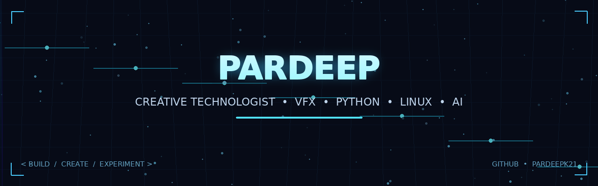

  

# Hey, I'm Pardeep 👋

### Creative Technologist | VFX Artist | Open-Source Explorer

I enjoy exploring the intersection of **creativity, code, and technology** — from visual effects and automation to Linux experiments and AI-powered tools.

- 🔭 Exploring open-source software, Linux, and practical AI tools
- 🐍 Interested in Python scripting and automation
- 🎬 Experienced with VFX, compositing, and creative workflows
- 🛠️ Learning by experimenting, building, and sharing
- 🌱 Always curious about what's possible with technology

---

## 📊 GitHub Activity

